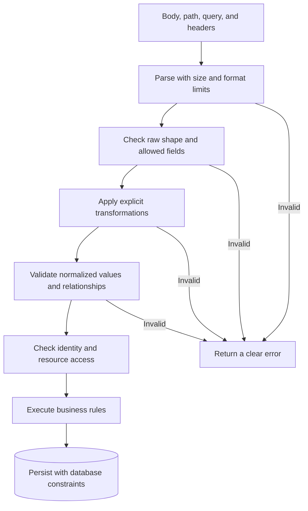

# Validation and Transformation — Please Submit a Quantity, Not a Novel

*Post 7 of 31 · [Series index](README.md)*

A customer submits an order with a quantity of `"several"`. The JSON parser accepts the message. The database would now like a word.

Parsing established that the request was valid JSON. It did not establish that the request made sense for our bookstore. Validation and transformation form the next part of that boundary.

Sriniously’s lesson places these responsibilities before significant business operations and distinguishes type, syntactic, semantic, and cross-field checks. It also demonstrates conversion of query parameters and explains why browser validation cannot replace server validation. This post develops those ideas through an original order contract.

## Decide what the service is allowed to receive

Our API accepts a list of book identifiers and quantities. It obtains prices and the authenticated customer identity through trusted server-side logic.

```json
{
  "items": [
    {"bookId": "book_42", "quantity": 2}
  ],
  "delivery": {"method": "shipping", "addressId": "addr_7"}
}
```

The contract can specify at least one item, a maximum of 20 line items, integer quantities between 1 and 10, allowed delivery methods, and a shipping address when shipping is selected. Those limits are design choices for this example.

We should also define a policy for unknown properties. If a client submits `isAdmin`, `discountPercent`, or `customerId`, blindly copying the payload into an internal model could let the client influence protected fields. Accept only the properties this operation permits. [Mass assignment guidance](https://cheatsheetseries.owasp.org/cheatsheets/Mass_Assignment_Cheat_Sheet.html)

## Separate the kinds of checks

| Check | Question | Bookstore example |
| --- | --- | --- |
| Type | Is this the expected kind of value? | Quantity is an integer |
| Syntax | Does it follow the expected format? | Identifier follows the documented structure |
| Semantics | Is the value meaningful here? | Requested quantity is within the allowed range |
| Cross-field | Do related values agree? | Shipping requires an address identifier |
| Authorization | May this caller use the resource? | Address belongs to the authenticated customer |
| Business invariant | Can the operation still succeed? | Enough stock remains when the order commits |

These responsibilities can live in different layers. Early input checks reject malformed requests cheaply. Authorization and business rules may need database information and must remain correct under concurrent requests.

The input validator cannot reserve stock merely by confirming that `quantity` is a positive integer. Another customer may buy the last copy a moment later, displaying the familiar inconsideration of also wanting the book.

## Put checks before side effects



The order of individual checks depends on the operation. A pipeline may validate a raw string, transform it, then validate the transformed result. Authentication can run earlier than the input pipeline where appropriate. The important property is that side effects do not precede the checks needed to authorize and safely perform them.

Controller code translates HTTP input and output. Service code expresses the operation’s rules. Repository code handles persistence. These boundaries let another entry point reuse the service without making HTTP parsing its business.

## Transformation is an explicit agreement

Our catalog accepts this query.

```text
/books?page=2&limit=20&available=false
```

The URL carries textual values. The application must define the accepted representation before turning them into typed inputs.

| Raw value | Our policy |
| --- | --- |
| `page=2` | Parse as integer 2 |
| `page=2abc` | Reject |
| `page=2.5` | Reject |
| `page=` | Reject |
| Missing page | Use documented default 1 |
| `available=false` | Parse as boolean false |
| `available=anything` | Reject |

Generic conversions can have surprising results. JavaScript’s `Boolean("false")` is true because it tests whether the string is nonempty. Prefix parsers can accept part of a string we intended to reject. Validation must enforce the accepted grammar and numeric range, rather than treating any conversion result as evidence of valid input.

Defaults should apply according to the contract. Missing, null, empty string, zero, and false are different inputs. A shortcut based on truthiness can erase a legitimate value. [Boolean conversion](https://developer.mozilla.org/en-US/docs/Web/JavaScript/Reference/Global_Objects/Boolean)

## Normalize deliberately

Trimming an optional search phrase can be useful. Silently trimming a password changes the secret. Treating a phone number as a number loses leading zeros and other information, so a string representation is generally more suitable.

Date input needs both a defined format and a real calendar value. A string can resemble a date while referring to a nonexistent day. For timestamps, specify the timezone interpretation. For email, syntactic validity does not demonstrate control of the mailbox. Verification is a separate workflow, and normalization should follow a deliberate identity policy rather than a universal lowercase rule. [Input validation guidance](https://cheatsheetseries.owasp.org/cheatsheets/Input_Validation_Cheat_Sheet.html)

## Validate collections and relationships

An array being an array is only its first qualification. For our order, validate each line item and identify its location when reporting errors. Decide whether duplicate book identifiers are rejected or combined, and make that behavior explicit.

Cross-field checks can express requirements such as a shipping address for delivery, a pickup location for collection, or agreement between two confirmation fields. Some conditions also depend on trusted data. A syntactically valid address identifier can still belong to someone else.

Avoid returning submitted secrets in errors. A field path and a correction instruction are usually enough. Validation should help the customer fix the input without making the response a second copy of everything they typed.

## An error should support a correction

Here is an illustrative response shape.

```json
{
  "error": "validation_failed",
  "details": [
    {
      "field": "items[0].quantity",
      "code": "out_of_range",
      "message": "Quantity must be an integer from 1 to 10."
    }
  ]
}
```

Use a consistent status policy. Malformed JSON can receive 400. Syntactically valid content that fails application validation can receive 400 or 422 according to the API contract. A conflict with current resource state may need 409 instead. Unexpected failures remain server errors. [HTTP status reference](https://developer.mozilla.org/en-US/docs/Web/HTTP/Reference/Status)

A database might reject invalid data, coerce it, or accept it according to its types, driver behavior, and constraints. Early validation makes the application’s expectations explicit instead of depending on one assumed database outcome.

## Browser checks improve the conversation

The website can immediately show that a quantity is missing or too large. That saves the customer an unnecessary round trip. The server still validates because API clients, scripts, modified browsers, and future applications can submit requests directly.

Database constraints remain useful as another layer. Uniqueness, foreign keys, and appropriate checks protect stored state across entry points. Stock allocation and other concurrent operations also need transactional designs. Passing a form validator is not a database lock. [PostgreSQL constraints](https://www.postgresql.org/docs/current/ddl-constraints.html)

There is another limit worth keeping clear. Validation does not replace parameterized database queries or context-appropriate output encoding. A perfectly valid book title may contain an apostrophe, and the database should receive it safely without requiring the author to reconsider their punctuation. [SQL injection prevention](https://cheatsheetseries.owasp.org/cheatsheets/SQL_Injection_Prevention_Cheat_Sheet.html)

## The boundary earns its keep

Before accepting an order, I now want to know which fields the client controls, how values are decoded, what transformations are permitted, which rules depend on other fields, and which invariants require trusted state.

That leaves the service with a much clearer job. It can place an order using defined inputs instead of discovering, halfway through the operation, that the requested quantity was an essay on abundance.

Based on [Sriniously’s validation and transformation lesson](https://www.youtube.com/watch?v=qedj_JjjL-U), with original bookstore rules and additional security clarifications.

[Previous — Authentication and Authorization](06-authentication-and-authorization.md) · [Next — Middleware](08-middleware.md) · [Series index](README.md)
