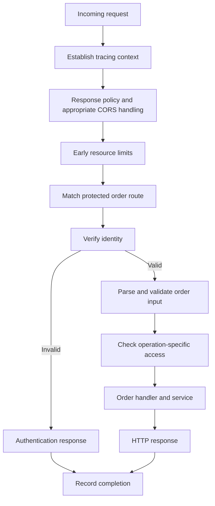

# Middleware — Before the Bookstore Takes Your Order

*Post 8 of 31 · [Series index](README.md)*

Our order handler has acquired several duties. It checks credentials, records timing information, parses JSON, checks permissions, places the order, and explains the result. It is beginning to resemble a bookseller who also maintains the fire alarm and audits everyone entering the building.

Middleware gives recurring request work a place in the application. This post develops the middleware portion of Sriniously’s lesson on controllers, services, repositories, and request context, using our bookstore as the example.

## A request passes through a sequence of decisions

Consider a customer submitting an order. Several operations apply to that request before the purchase logic can begin. We may need an identifier for tracing, limits on incoming content, authentication, and an audit of the eventual result.

A middleware component participates in the request lifecycle. Depending on its framework and purpose, it can inspect input, attach information, adjust response behavior, continue execution, or produce a response early. Express commonly exposes `request`, `response`, and `next`. Other frameworks use different interfaces. The transferable idea is reusable work around request handling. [Express middleware](https://expressjs.com/en/guide/using-middleware/)

## Continuing is an explicit action

Here is an illustrative authentication decision, expressed as pseudocode.

```text
authentication middleware
    read the credential
    verify it using the configured authentication mechanism
    if invalid
        return the appropriate authentication error
    attach verified identity to request context
    continue to the next component
```

An early response means the order handler never executes. That saves work and prevents the handler from placing an order on the assumption that somebody, somewhere, probably checked the customer.

Continuation also needs a clear contract. In an Express-style chain, a middleware that neither completes the response nor calls the next function can leave the request pending. Sending a response and then continuing normally can cause downstream code to attempt another response. [Express middleware](https://expressjs.com/en/guide/using-middleware/)

## Choose the scope of the policy

The bookstore has public catalog routes, private customer routes, and restricted staff routes. Their requirements differ.

| Scope | Example responsibility |
| --- | --- |
| Application | Establish request identifiers and basic response policy |
| Route group | Require authentication for customer account operations |
| Individual route | Require catalog-editing permission for a particular operation |
| Error path | Translate a known application failure into the agreed error response |

Applying a check everywhere can be just as deliberate a mistake as forgetting it. A public health endpoint might need to work without a customer session. Staff permissions should not accidentally become the entry requirement for browsing novels.

I would document the policy alongside route registration. Reusing a function is useful, but knowing which routes actually use it is what lets us reason about access.

## Order changes behavior

Suppose a component needs the verified customer identifier. It must execute after the component that establishes that identity. A parser must run before code that expects a parsed body. Completion logging should account for requests rejected by earlier checks.



This is a design for our example, rather than a universal registration recipe. Content parsing, route selection, limits, and authentication can be ordered differently depending on framework behavior and endpoint needs. The dependencies need to remain explicit.

## The response can unwind through wrappers

Some frameworks describe middleware as nested wrappers. The request travels inward through the layers, and the response returns outward through them. A layer can perform work before and after calling its wrapped component.

This model is useful for timing and response changes. An outer layer can record when execution begins, invoke the inner layer, then inspect the resulting response. An early return can skip the layers inside it while still returning through the wrappers already entered. Django documents this as an onion-like structure. [Django middleware](https://docs.djangoproject.com/en/5.2/topics/http/middleware/)

That also explains why “put every response operation last” is incomplete advice. The correct registration position depends on whether the framework uses forward handlers, response hooks, nested wrappers, or some combination.

## Error handling follows the framework’s rules

Express error-handling middleware uses four parameters and is registered after ordinary middleware and routes. Errors must reach that path through the supported mechanism. Express 5 forwards rejected promises from promise-returning handlers, while asynchronous work outside that chain still needs appropriate handling.

A central error handler does not catch every failure in every background task. Once response headers have been sent, it may also be too late to replace the response with a fresh JSON error. The application needs a deliberate behavior for partial output and broken connections. [Express error handling](https://expressjs.com/en/guide/error-handling/)

For the bookstore, expected failures should have predictable public representations. Unexpected details belong in controlled logs. A database stack trace is unlikely to help a customer decide whether to retry checkout.

## Common work has different boundaries

| Concern | What the component contributes |
| --- | --- |
| CORS | Headers and preflight behavior for permitted browser origins |
| Security headers | Consistent applicable browser response policies |
| Authentication | A verified identity for protected requests |
| Rate limiting | A controlled budget for calls over a time period |
| Parsing and validation | Defined input for downstream code |
| Logging and metrics | Evidence about the request and its outcome |
| Compression | An appropriate response coding where supported |

CORS does not authenticate callers. Omitting permission for browser JavaScript to read a response does not guarantee that the request never caused an operation. Backend authorization must still enforce access. [CORS guide](https://developer.mozilla.org/en-US/docs/Web/HTTP/Guides/CORS)

Rate limiting needs a suitable key and a shared view of usage when required across application instances. An IP address can represent many customers behind one network. When a proxy supplies client-address information, configure which proxy information is trusted. Return 429 when the policy is exceeded and expose useful retry information where appropriate. [Express proxy configuration](https://expressjs.com/en/guide/behind-proxies.html)

Logs should be selective. Record useful identifiers, route information, status, and duration while excluding credentials and unnecessary personal data. A checkout log should help diagnose the purchase without becoming another place to store the customer’s secrets. [OWASP logging guidance](https://cheatsheetseries.owasp.org/cheatsheets/Logging_Cheat_Sheet.html)

## Keep the purchasing rules recognizable

Middleware is a good home for repeated request concerns. Stock allocation, permitted discounts, and the rules for accepting an order still need a coherent application operation. Hiding those decisions in a long chain of generic hooks makes the system harder to explain.

When I inspect a protected route, I want to see which checks precede it, what identity they establish, what can terminate the request, and where failures go. The chain should reduce repeated work without making its order a memory test.

Next, we’ll follow the small amount of information these components need to share during one request.

Based on [Sriniously’s combined lesson](https://www.youtube.com/watch?v=hyc-7w3pee8), with original bookstore scenarios and framework clarifications from the linked documentation.

[Previous — Validation and Transformation](07-validation-and-transformation.md) · [Next — Request Context](09-request-context.md) · [Series index](README.md)
