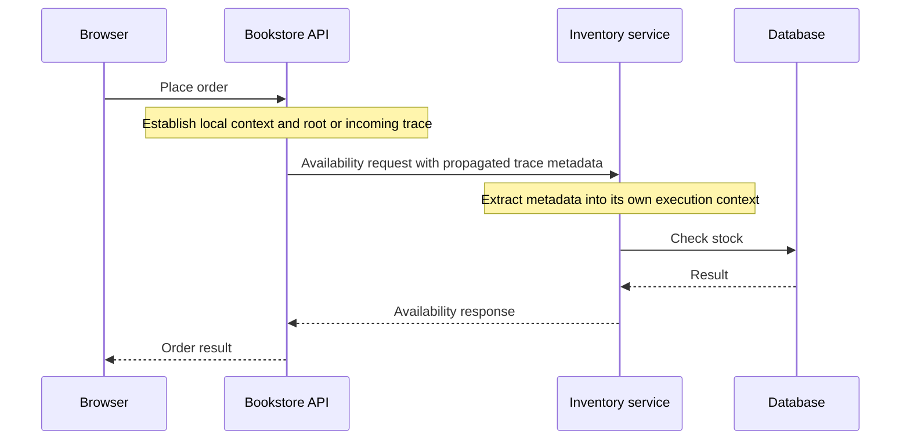

# Request Context — Keeping One Customer’s Business Together

*Post 9 of 31 · [Series index](README.md)*

The customer has authenticated, the request has an identifier, and the order service needs to know both. We could make every function discover them independently. We could also ask every employee in the bookstore to check the same receipt. There are more productive uses of a queue.

Request context gives information a scope and a path through the work of a request. This post develops the context portion of Sriniously’s combined lesson, then explores isolation, propagation, and cancellation through our bookstore.

## Give the information a lifetime

A request context commonly carries metadata such as a request identifier, verified identity, trace information, or a deadline. Its defining property is that it belongs to the relevant execution scope.

This differs from a customer session, which can span many requests, and from persistent order data. It also differs from application-wide configuration, which many requests may share.

An illustrative context might contain these fields.

```text
requestId     generated or validated at the entry boundary
principal     established by authentication
traceContext  established by tracing instrumentation
deadline      derived from the request's allowed time budget
```

Frameworks and runtimes expose these capabilities differently. Some attach state to the request. Some provide context-local storage. Some pass a context explicitly through function calls. The name alone does not establish its behavior.

## Shared between components, isolated between requests

Imagine two requests interleaving while they wait for the database.

```text
Request A authenticates customer A
Request A starts a database operation and waits
Request B authenticates customer B
Request A resumes
```

If both handlers use a single global `currentUser`, request A can resume with customer B’s identity. The code may look entirely reasonable when tested one request at a time.

Context-local mechanisms preserve state within the intended execution rather than using one ordinary global value for all work. Node.js provides AsyncLocalStorage for asynchronous context tracking. Create a distinct store for each request execution and understand how the chosen APIs propagate it. [Node.js asynchronous context](https://nodejs.org/api/async_context.html)

The isolation of the store is only part of the job. If several stores refer to the same mutable object, those references can still share data. Creating a new context while reusing a global principal object would give the bug rather better stationery.

## Establish identity at a trusted boundary

Suppose a customer submits an order payload containing `customerId`. That field expresses a claim made by the caller. Authentication supplies the principal the server has verified.

For an ordinary customer order, the service should use that verified identity when determining ownership. If an administrator can act for another customer, treat it as a separate authorized capability and record the distinction between the actor and the target.

The context can carry verified identity into later checks, but authorization still needs the resource and operation. Customer A’s valid session does not entitle them to use customer B’s shipping address. [OWASP authorization guidance](https://cheatsheetseries.owasp.org/cheatsheets/Authorization_Cheat_Sheet.html)

## Explicit parameters and context have different strengths

I would make the main inputs to our order operation visible at its boundary.

```text
placeOrder(executionContext, actor, validatedOrderInput)
```

The actor identifies who is performing the action. The input describes the requested purchase. The execution context provides cross-cutting information such as cancellation and trace correlation.

This is illustrative pseudocode. A project might use a typed command or another established representation. The aim is to make the operation understandable without asking readers to discover a hidden collection of required context keys.

Context reduces repetitive plumbing, but excessive ambient state can conceal dependencies. A field that every business operation requires may deserve an explicit parameter. A correlation identifier needed throughout logging is a different kind of concern.

## Trace a request across the shop’s services



A local context object does not automatically cross the network. Instrumentation injects a representation into a carrier such as HTTP headers, and the receiver extracts it into its own context. OpenTelemetry uses this propagation to connect spans across process boundaries.

A request ID can correlate logs, while a distributed trace describes related operations with their own spans. Incoming trace metadata is not proof of identity or authorization, and sensitive information needs care when crossing service boundaries. [OpenTelemetry context propagation](https://opentelemetry.io/docs/concepts/context-propagation/)

At a public entry point, validate or replace caller-supplied correlation identifiers according to policy. Their purpose is to help us find the request, rather than grant callers an opportunity to choose arbitrary log content.

## Cancellation asks work to stop

The customer closes the browser, or the request exceeds its time budget. Continuing an expensive query may waste resources.

Go’s context package carries deadlines, cancellation signals, and request-scoped values through API boundaries. Functions performing work should receive the relevant context and propagate it to operations that support cancellation. Derived cancellation functions need cleanup, and values should remain appropriate request metadata rather than becoming optional function arguments in disguise. [Go context documentation](https://pkg.go.dev/context)

Cancellation is cooperative. The signal must reach an operation that observes it. A deadline in a data structure does not interrupt arbitrary code on its own.

Most importantly, a canceled HTTP exchange does not prove that an order failed. A database commit may have succeeded before the connection disappeared. Retry behavior needs idempotency and a way to determine the operation’s outcome. Transport lifetime and transaction outcome are different facts.

## Background work needs a deliberate handoff

An email worker might outlive the HTTP request that accepted the order. Give the queued job the durable information it needs, such as an order identifier, plus appropriate correlation metadata. It needs its own execution lifetime and current access to the data it will use.

Do not accidentally retain an entire request object, credential, or open transaction just because a task needs a request ID. Decide which metadata is safe and useful to propagate. The job’s retry and cancellation policy also belongs to that job, rather than being inherited accidentally from a customer’s closed tab.

## Runtime context needs lifecycle discipline

Python provides ContextVar for context-local state, including asynchronous execution. Setting a value produces a token that can restore the previous value, and cleanup belongs in a reliable scope such as `finally`. Context-local state helps avoid leakage between concurrent executions, but it is still important to understand how the surrounding framework creates and runs tasks. [Python context variables](https://docs.python.org/3/library/contextvars.html)

The same questions apply across runtimes. Who creates the scope? Which calls inherit it? What happens when work is detached? What prevents a missing identity from silently becoming a default identity? A required security value should fail safely when absent.

## The useful context is a small one

For our bookstore, I want each request’s logs, verified actor, deadlines, and downstream work to stay connected without becoming entangled with another customer’s request. Explicit business inputs and well-scoped execution metadata make that possible.

Next, we’ll give the purchasing operation a home of its own and examine what the HTTP handler should do around it.

Based on [Sriniously’s combined lesson](https://www.youtube.com/watch?v=hyc-7w3pee8), with original bookstore examples and additional runtime and tracing guidance.

[Previous — Middleware](08-middleware.md) · [Next — Handlers and Controllers](10-handlers-and-controllers.md) · [Series index](README.md)
