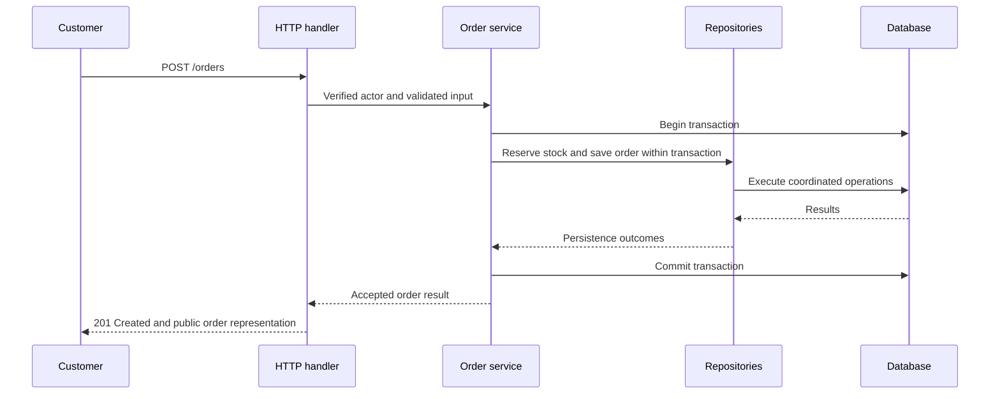

# Handlers and Controllers — Giving Checkout a Job Description

*Post 10 of 31 · [Series index](README.md)*

Our checkout handler began as a convenient place to put code. It now parses requests, checks stock, calculates totals, writes orders, sends receipts, and chooses error messages. Convenience has developed a management problem.

Separating HTTP handling, application operations, and persistence gives us a way to reason about that work. This post develops the handlers, services, and repositories portion of Sriniously’s combined lesson through an illustrative bookstore checkout.

## A pattern earns its place by clarifying responsibilities

A handler or controller receives a routed request and adapts it to the application. A service expresses an operation. A repository provides a boundary for persistence access.

The vocabulary varies between projects. A controller might contain several route actions, while a handler might be a single callable. Frameworks also differ in what they provide to that callable and how it returns a response.

We can put the whole operation in one function. We choose separation when it makes changes easier to understand, keeps repeated policy consistent, or allows the same operation to serve another entry point. Three directories do not provide those benefits automatically.

## Keep HTTP translation near the edge

The checkout handler’s responsibilities might be these.

```text
read the route-specific input
use the configured parsing and validation pipeline
obtain the verified actor and execution context
invoke the place-order operation
translate the result into the public HTTP contract
```

Some steps may already have happened in middleware or framework binding. Follow the actual request pipeline before adding another parser or duplicating validation. For example, FastAPI can use declared request models to parse and validate bodies before a path operation receives them. That behavior comes from the framework configuration, rather than being a universal rule for Python programs. [FastAPI request bodies](https://fastapi.tiangolo.com/tutorial/body/)

The handler should also expose an intentional response representation. A persistence object may include internal fields that do not belong in the public API. Framework response models can help define and filter output. [FastAPI response models](https://fastapi.tiangolo.com/tutorial/response-model/)

## The service tells the purchasing story

Consider the application operation below. It is pseudocode, and the names express intended guarantees rather than supplying an implementation.

```text
placeOrder(context, actor, input)
    verify the actor may place this order
    begin the operation's transaction
        load authoritative book and pricing information
        reserve inventory using concurrency-safe database operations
        calculate the accepted total
        persist the order and its line items
        persist any required durable follow-up work
    commit
    return the accepted order result
```

The service coordinates a business operation and its dependencies. It should not need an HTTP response object to decide whether an order can be accepted. A scheduled process or staff tool might invoke the same operation through a different adapter.

A service layer defines application operations and coordinates the responses needed to carry them out. Its useful boundary is the operation the application offers. [Service Layer pattern](https://martinfowler.com/eaaCatalog/serviceLayer.html)

## Persistence operations should have clear contracts

Compare these illustrative signatures.

```text
findBookById(bookId) -> optional book
listBooks(filters, pagination) -> page of books
createOrder(transaction, orderData) -> created order
```

The return types make the caller’s expectations clear. One function that unpredictably returns a book, a list, or an unrelated success flag requires the caller to keep rediscovering its meaning.

A repository mediates between domain-oriented code and data access. It can encapsulate query construction and mapping without making the service depend on table details everywhere. An existing ORM or project abstraction may already meet that need, so an extra wrapper needs a purpose. [Repository pattern](https://martinfowler.com/eaaCatalog/repository.html)

For ordering choices such as `sort=title`, translate validated options into known query expressions. Parameterized values protect data inputs, while SQL identifiers and ordering expressions require a suitable allowlist or safe query-building mechanism. [SQL injection prevention](https://cheatsheetseries.owasp.org/cheatsheets/SQL_Injection_Prevention_Cheat_Sheet.html)

## A call sequence does not establish atomicity



If reducing stock succeeds but saving the order fails, independent commits can leave the bookstore with inconsistent state. The application needs an appropriate transaction boundary around the coordinated changes. PostgreSQL transactions group operations so the changes can commit together or be rolled back. [PostgreSQL transactions](https://www.postgresql.org/docs/current/tutorial-transactions.html)

Concurrency still matters within that boundary. Reading a count and later decrementing it needs suitable locking, conditional updates, or another deliberate strategy. Transaction isolation determines which concurrent effects are possible, and some failures require retrying the whole transaction. The word “transaction” is not a substitute for choosing the guarantees the operation requires. [PostgreSQL transaction isolation](https://www.postgresql.org/docs/current/transaction-iso.html)

## External side effects need their own plan

An email provider does not participate in our ordinary database transaction. Sending a receipt before commit can announce an order that never becomes durable. Sending it afterward without a durable handoff creates another failure window if the process stops between commit and the send.

A transactional outbox can record the order and a follow-up event in the same database transaction. A separate publisher or worker processes that durable record. Delivery can repeat, so consumers need an appropriate duplicate-handling strategy. We will explore the pattern further when the series reaches background work. [AWS transactional outbox guidance](https://docs.aws.amazon.com/prescriptive-guidance/latest/cloud-design-patterns/transactional-outbox.html)

For now, the handler should not quietly acquire responsibility for resolving that failure window. The purchase operation needs a stated durability contract.

## Translate failures deliberately

| Application outcome | Illustrative HTTP treatment |
| --- | --- |
| Malformed request content | 400 |
| Unacceptable application input | Documented 400 or 422 policy |
| Missing valid authentication | 401 with applicable authentication challenge |
| Forbidden operation | 403, or a deliberate resource-concealment policy |
| Book or order absent | 404 where appropriate |
| Requested purchase conflicts with current stock | 409 under our example contract |
| Order created successfully | 201 with a public representation and appropriate Location |
| Unexpected internal failure | Sanitized 500 response and controlled diagnostic logging |

These mappings belong to the public contract. An application error can describe an unavailable item without importing an HTTP response object into the order service. Central error handling may perform the final mapping consistently. [HTTP semantics](https://www.rfc-editor.org/rfc/rfc9110.html)

## The boundary should make changes easier

If the response schema changes, we can inspect the adapter. If the purchasing rule changes, we can inspect the service. If query behavior changes, we can inspect persistence code. Each boundary gives us a smaller place to begin the investigation.

It also gives tests a useful focus. Exercise HTTP behavior through the route, business outcomes through the application operation, and database guarantees against the actual persistence mechanism. A mocked repository cannot establish whether two concurrent transactions can sell the last copy.

I want the checkout handler to read like an account of the request. I want the service to explain how the store accepts a purchase. That is enough structure to be useful, without appointing a committee to carry a book from one shelf to another.

Based on [Sriniously’s combined lesson](https://www.youtube.com/watch?v=hyc-7w3pee8), with original checkout scenarios and additional persistence guidance.

[Previous — Request Context](09-request-context.md) · [Series index](README.md) · [Next — CRUD in Depth](11-crud-in-depth.md)
