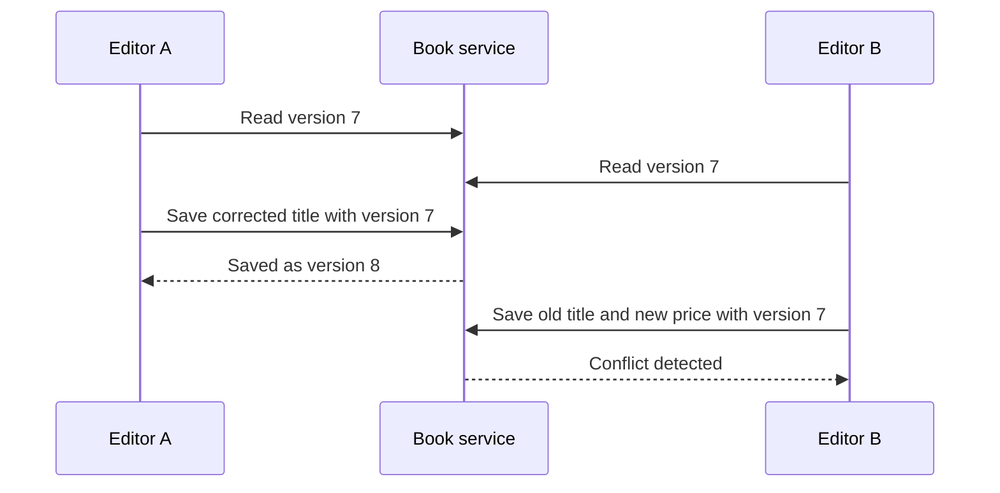

# CRUD in Depth — Four Verbs, Several Consequences

*Post 11 of 31 · [Series index](README.md)*

Create, read, update, delete. Four operations, which sounds like a pleasant afternoon until two staff members edit the same book and a customer asks where their order went.

Our bookstore can now receive a request and hand it to an application service. The next question is what that service actually promises when it changes data. CRUD gives us useful vocabulary. The interesting work begins with the guarantees attached to each operation.

This post develops the CRUD examples from Sriniously’s REST API design lesson using our bookstore. The SQL and request examples are illustrative contracts, not a complete application.

## Start with the object being managed

A book listing has an identity, a title, a price, and an availability status. An order records a purchase and its line items. They deserve different rules even if both live in tables.

| Operation | Book catalog example | Decision we must make |
| --- | --- | --- |
| Create | Add an edition to the catalog | Which fields may staff supply? |
| Read | Retrieve one book or browse a page | Which records and fields may this caller see? |
| Update | Correct a title or change a price | How do we detect a conflicting edit? |
| Delete | Remove a listing from sale | What happens to historical orders? |

An endpoint is an agreement about these decisions. A database row is only part of the implementation.

## Create means accepting responsibility for a new record

Suppose a catalog editor sends this request.

```http
POST /books HTTP/1.1
Content-Type: application/json

{"title":"The Art of Procrastination","priceMinor":1800,"currency":"USD"}
```

The service verifies catalog permissions, validates the accepted fields, creates its own identifier and timestamps, persists the record, and returns a public representation. It does not accept a caller-supplied `createdBy` as proof of who performed the operation.

For our API, a successful creation returns `201 Created` with a `Location` header pointing to the new resource. The exact response body is part of our documented contract. [HTTP creation responses](https://www.rfc-editor.org/rfc/rfc9110.html#section-15.3.2)

Now the awkward case. The database commits, but the connection drops before the client receives the response. The client cannot tell whether creation succeeded. Repeating the request could create a duplicate.

For operations where duplication matters, design an application-level idempotency mechanism. Associate a client-generated key with the actor, operation, request fingerprint, and stored outcome. Claim the key atomically. Concurrent retries with the same key must converge on the same operation, while a changed payload under that key should be rejected. Define retention and in-progress behavior too. A header name alone supplies none of these guarantees.

## Read one and read many are different contracts

`GET /books/book_42` returns one visible catalog record. `GET /books` returns a bounded collection. Returning every book is a strategy that remains excellent until we acquire books.

For the collection endpoint, decide the default page size, maximum size, allowed filters, stable ordering, and continuation format. Our example might accept this.

```text
GET /books?status=available&limit=20&sort=title
```

The implementation orders by title and then ID, so equal titles have a deterministic tie-breaker. It applies visibility restrictions before pagination. Otherwise an apparently full page can become mostly empty after unauthorized rows are removed, and metadata may reveal records the caller should never know about.

An empty collection is normally a successful result with an empty list. A single resource that is absent or intentionally hidden can use `404` under our API policy. These are separate situations, even if both involve finding zero rows.

Select public fields deliberately. A convenient `SELECT *` can become an accidental announcement when an internal field is added later.

## Update needs a definition of change

Our editor wants to correct one title. We use a PATCH contract that accepts a small set of editable fields. A full replacement contract would instead need clear rules for the complete client-managed representation. Server-managed identity and audit fields stay under server control.

PATCH is not inherently idempotent. Setting a title to a particular value can be idempotent. Applying an instruction to increase stock by one generally is not. Its semantics depend on the patch format and operation. [PATCH specification](https://www.rfc-editor.org/rfc/rfc5789.html#section-2)

Two editors introduce another problem.



Without a concurrency check, the second save can overwrite the first editor’s correction. One approach is optimistic concurrency through an atomic conditional update.

```sql
UPDATE books
SET title = $1,
    version = version + 1
WHERE id = $2 AND version = $3
RETURNING id, title, version;
```

Here `$1` through `$3` are bound parameters supplied through a database driver. If no row is updated, the service distinguishes an unavailable resource from a stale version according to its visibility policy. It must not report success merely because the SQL statement executed.

An HTTP API can expose a strong ETag and require `If-Match` for edits. A failed precondition then produces `412 Precondition Failed`. An application that uses an explicit version field may document a different conflict response. Keep the public contract consistent. [HTTP conditional requests](https://www.rfc-editor.org/rfc/rfc9110.html#section-13.1.1)

## Delete deserves a retention policy

Deleting a catalog listing should not make an old receipt incomprehensible. Store the accepted title, unit price, and currency on each order line, so purchase history survives catalog changes.

We can archive a book by marking it unavailable, or physically remove a record when retention rules permit. Archiving preserves data but adds responsibilities. Every relevant query must respect the archive state, uniqueness rules need thought, and retained data still exists for privacy and security purposes.

Foreign keys can prevent dangling references, with explicit choices about restricting or cascading deletion. Cascading an entire purchase history because someone removed a book would be an ambitious interpretation of housekeeping. [PostgreSQL foreign keys](https://www.postgresql.org/docs/current/ddl-constraints.html#DDL-CONSTRAINTS-FK)

A repeated deletion can return a different status without changing the intended final state. Idempotency concerns the effect of repetition, rather than requiring identical responses. [HTTP idempotent methods](https://www.rfc-editor.org/rfc/rfc9110.html#section-9.2.2)

## Check behavior at the boundaries

For our bookstore, useful checks include these cases.

- A customer cannot create or edit catalog records.
- A retry does not produce a second accepted order under the same idempotency key.
- A stale editor cannot silently overwrite a newer version.
- Collection limits and visibility rules apply together.
- Archiving a book preserves historical order details.
- A failed multi-step operation leaves no partial purchase behind.

These checks examine promises a caller depends on. Merely exercising four endpoints would leave most of those promises unexamined.

CRUD becomes useful when each operation has a clear answer to who may act, what may change, what survives failure, and how concurrent work behaves. The four verbs fit on a flashcard. Their consequences require the rest of the application.

## Lesson connection

This article expands the organizations and projects CRUD walkthrough in Sriniously’s [REST API design lesson](https://www.youtube.com/watch?v=RG6q57DwV8Y), roughly 57–116 minutes. The bookstore examples, retry design, and concurrency discussion are original extensions. Post numbers follow this series’ editorial roadmap rather than matching video numbers one for one.

[Previous — Handlers and Controllers](10-handlers-and-controllers.md) · [Series index](README.md) · [Next — REST API Design](12-rest-api-design.md)
