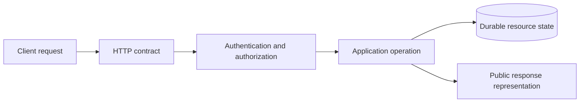

# REST API Design — An Agreement the Client Can Keep

*Post 12 of 31 · [Series index](README.md)*

A bookstore API with `/getBooks`, `/fetchBook`, and `/actuallyDeleteBookFinal` has achieved variety. Predictability remains on the backlog.

Good API design gives clients a coherent way to name resources, request changes, and interpret outcomes. That coherence matters when the frontend is written by somebody else, maintained next year, or retried automatically after a connection failure. Sometimes all three happen before lunch.

This post follows Sriniously’s REST design lesson and builds a public contract for our bookstore.

## A resource has an identity and a representation

A book is the resource. Its URI identifies it. The JSON returned to a customer is one representation of that resource, and the service may hold considerably more information internally.

```text
Resource identity      /books/book_42
Public representation  title, author names, sale price, availability
Internal information   supplier notes, acquisition costs, moderation history
```

REST describes an architectural style with client-server separation, stateless requests, cache constraints, a uniform interface, layered components, and optional code on demand. The uniform interface includes resource identification, representation-based manipulation, self-describing messages, and hypermedia-driven interactions. A JSON API with sensible URLs does not automatically satisfy all of those constraints. [Fielding’s REST architectural style](https://ics.uci.edu/~fielding/pubs/dissertation/rest_arch_style.htm)

For this bookstore, we are designing a resource-oriented HTTP API and being explicit about its behavior. That is a useful engineering task even without claiming architectural purity.

## Begin with user actions, then identify resources

The customer browses books, maintains a cart, places an order, and checks its status. Catalog staff maintain listings. These activities suggest books, carts, cart items, orders, and order items.

| Purpose | Example endpoint | Contract question |
| --- | --- | --- |
| Browse catalog | `GET /books` | How are results filtered and paginated? |
| Read a listing | `GET /books/{bookId}` | Which details are publicly visible? |
| Create a listing | `POST /books` | Which staff role may create one? |
| Edit a listing | `PATCH /books/{bookId}` | Which patch format and concurrency rule apply? |
| Read a cart | `GET /carts/{cartId}` | Does the actor own it? |
| Set an item quantity | `PUT /carts/{cartId}/items/{bookId}` | Is this a complete item representation? |
| Place an order | `POST /orders` | How are prices and retries handled? |
| Request cancellation | `POST /orders/{orderId}/cancellations` | Is the order still cancellable? |

The cancellation resource describes a business action and its outcome. We avoid giving clients an unrestricted `status` setter that can move a shipped order back to pending.

Nested paths express a useful relationship. They do not prove ownership, and an identifier that is hard to guess does not provide authorization. The service still verifies access to the specific cart or order.

## Use method semantics consistently

GET retrieves a representation. PUT creates or replaces the state of a resource at a known target according to the contract. POST asks a target resource to process the supplied representation. DELETE requests removal of the target’s association with its current functionality. Safe methods and idempotent methods have defined meanings that support automation and retries. [HTTP method semantics](https://www.rfc-editor.org/rfc/rfc9110.html#section-9)

For our cart item, `{"quantity":2}` means the desired quantity is two. Repeating it should not keep adding two. An “add two more” command would need different semantics and retry protection.

PATCH applies modifications described by a patch document. Specify the accepted media type and what omitted fields, nulls, and arrays mean. A PATCH request is not automatically safe to repeat. [PATCH method](https://www.rfc-editor.org/rfc/rfc5789.html#section-2)

Consistency also means that a read operation cannot secretly place an order. Browsers, crawlers, and prefetchers should be able to retrieve a link without purchasing our remaining inventory.

## Design collections before they grow

Consider this example request.

```text
GET /books?author=perry&sort=title&limit=20&after=opaque-cursor
```

Use query parameters for optional collection controls and path segments for resource identity. Validate limits, allowlist sort fields, and document the default order. A cursor should encode enough information to continue the chosen ordering, including a unique tie-breaker, while remaining an implementation detail for clients.

Offset pagination is simple and can suit small administrative lists. On a changing catalog, inserted or deleted rows can shift later offsets. A cursor based on a stable ordering can provide more reliable continuation, but it does not automatically freeze the dataset into a snapshot. Decide whether that stronger guarantee is needed.

Our illustrative response shape is intentionally small.

```json
{
  "items": [
    {"id":"book_42","title":"The Art of Procrastination"}
  ],
  "nextCursor":"example-opaque-token"
}
```

If an exact total is expensive and the UI does not need it, leave it out. A request for twenty books should not quietly volunteer to count the entire shop.

## Make successful and failed outcomes understandable

Choose responses according to what happened. Creation, successful retrieval, an accepted asynchronous operation, and a successful operation with no response content communicate different things. In particular, `202 Accepted` is not a promise that background work has finished. Give callers a way to inspect its status when the workflow requires it. [HTTP success status codes](https://www.rfc-editor.org/rfc/rfc9110.html#section-15.3)

For errors, use a stable machine-readable format. RFC 9457 defines Problem Details and permits application-specific extensions. This example is a proposed bookstore error, with a relative type URI that our real service would need to document.

```json
{
  "type":"/problems/insufficient-stock",
  "title":"Insufficient stock",
  "status":409,
  "detail":"The requested quantity is no longer available.",
  "instance":"/requests/req_123",
  "code":"INSUFFICIENT_STOCK"
}
```

Serve that format with `application/problem+json`. Clients should branch on stable identifiers, rather than parsing a sentence that somebody may rewrite. Keep stack traces, SQL, credentials, and private record details out of public responses. [Problem Details for HTTP APIs](https://www.rfc-editor.org/rfc/rfc9457.html)

## Stateless requests can still use a database

Statelessness does not mean the store forgets orders. It means the interaction does not depend on conversational client context stored on a particular server between requests. Each request carries the information needed to interpret it, while durable resource state lives in storage. [REST stateless constraint](https://ics.uci.edu/~fielding/pubs/dissertation/rest_arch_style.htm#sec_5_1_3)



A load balancer can route requests to different application instances without changing the meaning of an order ID. Shared authentication and persistence arrangements still need deliberate design.

## Evolve the contract with the people using it

Renaming a field, changing a type, altering pagination, or changing the meaning of a status can break clients even when every URL remains unchanged. Adding a field can also trouble strict clients, so compatibility needs an agreed policy and representative checks.

Document examples, permissions, error codes, sorting rules, nullable fields, and retry behavior. Version a contract when the migration requires it, and communicate the transition. A `/v2` prefix provides a label. It does not perform the migration on anyone’s behalf.

The useful result is a client that can predict an unfamiliar endpoint from the rest of the API. Every avoidable surprise we remove is one fewer conversation beginning with “technically, that one works differently.”

## Lesson connection

This article draws on Sriniously’s [REST API design lesson](https://www.youtube.com/watch?v=RG6q57DwV8Y), especially representations, method semantics, resource modeling, nested resources, and collection design. The bookstore contract and failure examples extend the lesson. The HTTP and PATCH references above clarify retry semantics.

[Previous — CRUD in Depth](11-crud-in-depth.md) · [Series index](README.md) · [Next — Databases](13-databases.md)
