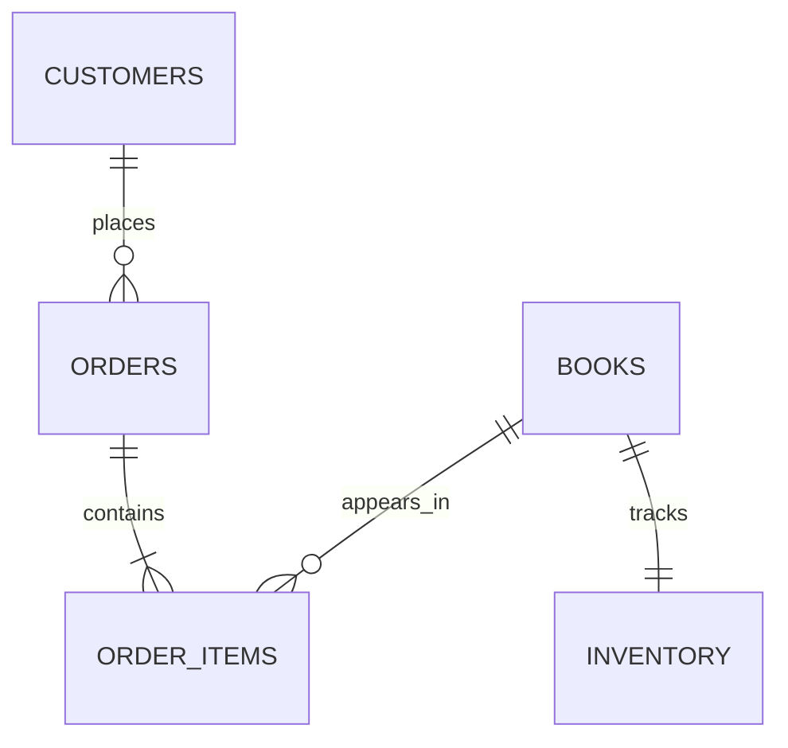

# Databases — The Bookstore Remembers

*Post 13 of 31 · [Series index](README.md)*

Keeping orders in a Python dictionary gives us an impressively simple persistence layer. Restarting the process reveals how much work the word “persistence” was doing.

A backend needs storage that can preserve information, enforce rules, coordinate concurrent changes, and retrieve useful answers. A database management system supplies tools for those jobs. Choosing one also means choosing operational responsibilities, including backups, access controls, monitoring, and recovery.

This post develops Sriniously’s PostgreSQL lesson through the schema and queries our bookstore needs. The examples are educational fragments, rather than a complete deployment or migration package.

## A file can store data. A DBMS manages competing demands

Writing orders into a JSON file is possible. Then two requests try to rewrite it, a process exits halfway through a write, and a staff member needs orders sorted by customer and date. We begin building locking, recovery, indexing, and query machinery around the file.

A DBMS already addresses those classes of problem through defined guarantees. We still have to use its transactions correctly and understand durability settings. “Saved to the database” is a claim about a configured system, not a substitute for knowing how it behaves during failure.

Relational systems organize data into relations and support constraints and queries across them. Document, key-value, graph, and other databases make different modeling and access tradeoffs. Neither “SQL” nor “NoSQL” alone tells us whether a particular configuration meets our consistency, availability, or durability needs.

For this bookstore, PostgreSQL gives us a practical relational starting point. Orders, books, customers, and line items have explicit relationships, and we need transactions around purchases.

## Model facts and relationships



The diagram expresses our intended accepted-order model. A production schema must enforce or otherwise maintain each rule. For example, a foreign key from order items to orders does not by itself require every order to contain an item.

| Table | Purpose | Example fields |
| --- | --- | --- |
| `customers` | Customer identity | ID, contact details |
| `books` | Current catalog information | ID, title, current price, archive state |
| `inventory` | Available units in this simple model | Book ID, available quantity |
| `orders` | Purchase-level facts | ID, customer ID, status, creation time |
| `order_items` | Accepted purchase details | Order ID, book ID, quantity, unit price, title snapshot |

The current catalog price belongs on the book. The price actually accepted by a customer belongs on the order line. If tomorrow’s sale rewrites yesterday’s receipt, we have accidentally built a time machine for accounting.

Separate facts that change independently. A book with several authors may need an authors table and a linking table, rather than comma-separated names. Conversely, a structured attribute that is rarely queried may fit a JSON field. Flexible storage still needs application rules and a plan for schema evolution.

## Choose types that express the data

Use integer or UUID identifiers according to system requirements, text for titles, and deliberate date/time types. A timestamp representing an event should have a clear timezone policy.

For this series, prices use integer minor units with an explicit currency. USD 18.00 is represented as `1800` and `USD`. Not every currency uses two decimal places, so conversion belongs to a currency-aware policy. Exact decimal types are another option. Binary floating point should not quietly decide how a customer’s receipt rounds.

This small PostgreSQL table illustrates several protections.

```sql
CREATE TABLE inventory (
    book_id uuid PRIMARY KEY REFERENCES books(id),
    available integer NOT NULL CHECK (available >= 0)
);
```

The primary key gives each book at most one inventory row. The foreign key requires a corresponding book. `NOT NULL` and `CHECK` prohibit missing or negative quantities. These constraints protect writes from scripts and background jobs as well as the web API. Cross-row business rules need additional mechanisms. [PostgreSQL constraints](https://www.postgresql.org/docs/current/ddl-constraints.html)

## Query through parameters

Suppose we want a customer’s recent orders. The application binds the customer ID as a value through its database driver.

```sql
SELECT id, status, created_at
FROM orders
WHERE customer_id = $1
ORDER BY created_at DESC, id DESC
LIMIT 20;
```

The `$1` placeholder is PostgreSQL-style notation. A Python driver may use a different placeholder syntax. Follow that driver’s parameter-binding interface rather than interpolating user input into SQL strings. PostgreSQL also supports server-side prepared statements with typed parameters. [PostgreSQL PREPARE](https://www.postgresql.org/docs/current/sql-prepare.html)

Values and identifiers are different. A user-supplied `sort` option should map to a known column and direction. Binding a value is not a general method for substituting arbitrary SQL syntax.

Also watch for the N+1 query pattern. Fetching twenty orders and then issuing one extra query per order for line items can turn one screen into twenty-one trips. A suitable join or batched second query may solve it. Measure row counts and query plans before choosing an approach that duplicates huge amounts of data.

## Transactions group changes into an operation

Checkout needs to reserve inventory, create an order, and create its line items. Those database changes should commit together or roll back together. Otherwise the shop can lose inventory without recording who bought it.

ACID gives us useful categories. Atomicity concerns all-or-nothing transaction effects. Consistency concerns preserving defined invariants. Isolation concerns interactions between concurrent transactions. Durability concerns committed changes surviving failures under the system’s guarantees.

Isolation has levels and tradeoffs. PostgreSQL’s default Read Committed level gives each statement a snapshot of committed data, rather than freezing all statements in a transaction to one snapshot. Serializable transactions provide stronger protection but may require the application to retry after serialization failures. Simply adding `BEGIN` does not make every read-then-write algorithm safe. [PostgreSQL transaction isolation](https://www.postgresql.org/docs/current/transaction-iso.html)

The next post uses a conditional inventory update to examine that problem directly.

## Index the questions the application asks

Our recent-orders query suggests an index beginning with the customer filter and continuing through the ordering fields.

```sql
CREATE INDEX orders_customer_recent_idx
ON orders (customer_id, created_at DESC, id DESC);
```

That is a candidate, not a performance guarantee. Data distribution, table size, selected columns, and the rest of the workload influence the plan. Every additional index consumes storage and adds write maintenance.

Use `EXPLAIN` to inspect a plan and `EXPLAIN ANALYZE` to compare estimates with execution. The latter actually runs the statement, so write queries need particular care. A sequential scan can be reasonable for a small table or a query returning much of it. “Index scan” is not an award the query must win. [Using EXPLAIN](https://www.postgresql.org/docs/current/using-explain.html)

## Change schemas with a migration plan

A migration records a schema change in version control. Seed data supplies initial or sample records. Keeping them distinct helps us avoid shipping a fictional customer to production as a surprise stakeholder.

When adding a required field to an existing table, consider an expansion sequence. Add a compatible field, deploy code that understands it, backfill existing records, verify the result, and then enforce the stronger requirement. Large-table locks, backfill load, and mixed application versions affect the rollout.

A down migration cannot reliably reconstruct data that was deleted. Recovery may require a forward fix or a restore, so backup procedures should include a tested restoration path. An untested backup is an optimistic file collection.

Database design connects the facts we store, the rules we protect, and the queries we need. For our bookstore, the reward is reassuringly ordinary. A restart no longer resets the business.

## Lesson connection

This article draws on Sriniously’s [Mastering Databases with Postgres](https://www.youtube.com/watch?v=F7Vwp2Xo5Do), including persistence, DBMS responsibilities, data types, relationships, migrations, parameterized queries, and indexing. The bookstore schema and operational discussion are original extensions. PostgreSQL details are linked to the official documentation above.

[Previous — REST API Design](12-rest-api-design.md) · [Series index](README.md) · [Next — Business Logic](14-business-logic.md)
