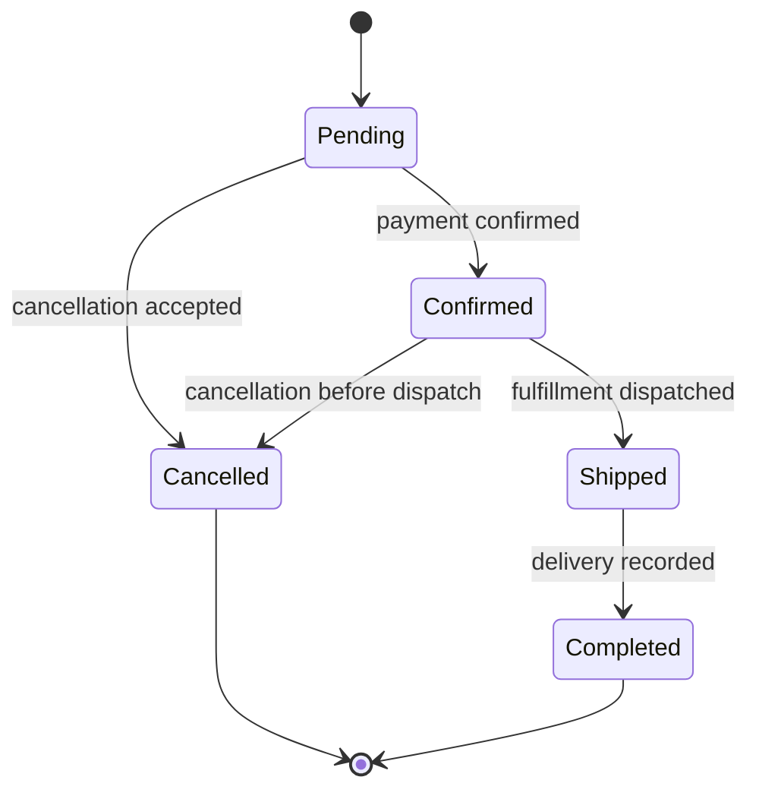

# Business Logic — What the Place Order Button Promised

*Post 14 of 31 · [Series index](README.md)*

The request is valid JSON. The customer is authenticated. The database connection works. We can still charge the wrong amount and sell the same last copy twice.

Business logic defines what a valid operation means for the store. A positive quantity is an input rule. Accepting that quantity only when enough stock can actually be reserved is a business rule that must hold during concurrent requests too.

This post connects our service-layer discussion to the persistence and resource-design lessons. It is an original bookstore walkthrough, rather than a claim that the playlist contains a separate lesson with this exact title.

## Write the promises before the implementation

For our simplified checkout, an accepted order promises the following.

- The actor may buy through this account and use the selected cart.
- Each requested book is eligible for sale.
- Quantities and supported currency are valid.
- Prices come from an authoritative server-side policy.
- Inventory is reserved without becoming negative.
- The order records the accepted items and price calculation.
- A retry under the same operation key does not create another order.

Payment capture and shipping introduce further rules. Here we keep order acceptance separate from payment processing. An accepted order is not evidence that a payment provider has successfully charged anyone.

These promises tell us where to look for failure. They also prevent the handler from growing into a collection of unrelated conditions that nobody wants to edit on Friday.

## Give the application operation a clear boundary

The HTTP adapter reads the validated request and verified actor. An application service coordinates checkout. Domain functions express rules such as pricing and allowed order transitions. Persistence code performs the required database operations.

The separation need not require a class for every noun. A small, well-named function can express a rule perfectly well. What matters is that the rule can be understood and exercised without manufacturing an HTTP response object.

An illustrative operation might look like this.

```text
placeOrder(actor, cartId, operationKey)
    establish access to the cart
    begin database transaction
        claim or retrieve the actor-scoped operation key
        load the cart and authoritative sale information
        validate the requested purchase under current policy
        reserve inventory in a consistent book order
        calculate and record the accepted totals
        persist order and immutable line-item snapshots
        persist a durable order-created event
        record the operation outcome
    commit
    return accepted order
```

This is pseudocode. It names required guarantees without supplying an implementation. In a real service, deciding what to lock, when to recheck permissions, and how to handle an in-progress retry is part of the design.

## Put calculations where they can be reasoned about

Consider a pure pricing function that receives authoritative line prices, quantities, a currency, and an applicable discount policy. It returns a breakdown without reading an HTTP request or sending an email.

For an illustrative USD order, two copies at 1,800 cents each produce a subtotal of 3,600 cents. A ten-percent eligible discount produces 360 cents off, leaving 3,240 cents before any tax or shipping. Real tax rules and rounding policies need explicit requirements. We should not improvise them through floating-point arithmetic and good intentions.

Record the accepted unit prices, discount breakdown, currency, and relevant policy version where needed. An order history should explain what the customer agreed to, even after a promotion expires.

Never accept a client’s `total`, `discountApproved`, or `isPaid` as authoritative merely because it passed type validation. Those fields describe decisions the server or trusted integration must make.

## The last-copy problem is a concurrency problem

Suppose inventory is one. Two requests read that value before either writes. Both pass an `available >= quantity` check. If each then creates an order, our store has sold two books and acquired one apology.

A conditional update can combine the inventory decision with its mutation.

```sql
UPDATE inventory
SET available = available - $1
WHERE book_id = $2
  AND available >= $1
RETURNING available;
```

The application must already require a positive integer quantity. For one inventory row in PostgreSQL under Read Committed, a competing update waits as needed and the condition is re-evaluated against the updated row. The losing request can then receive no returned row. Treat that as reservation failure and roll back its order transaction. [PostgreSQL Read Committed behavior](https://www.postgresql.org/docs/current/transaction-iso.html#XACT-READ-COMMITTED)

For several books, reserve them in a consistent order to reduce deadlock risk, and roll back every reservation if any item fails. Deadlocks or serialization failures may still need bounded retries of the entire transaction. Retrying just the final statement can preserve the wrong assumptions.

A nonnegative database constraint provides another protection, but it does not replace the complete purchasing workflow. [PostgreSQL check constraints](https://www.postgresql.org/docs/current/ddl-constraints.html#DDL-CONSTRAINTS-CHECK-CONSTRAINTS)

## Model changes as allowed transitions

An order status should tell us which actions remain valid. This deliberately simplified model concerns fulfillment after acceptance.



Returns, refunds, payment failures, and reservation expiry would need further states or related processes. We should add those according to requirements, rather than treating this sketch as a complete commerce model.

When payment confirmation arrives twice, the second notification must not reserve stock again or issue another fulfillment request. When cancellation races with dispatch, an atomic state check must decide which transition wins. Reading the state, thinking about it, and saving later leaves room for another request to change the answer.

## External effects have their own failure boundary

Writing an order and sending a message involve two systems. A database transaction cannot ordinarily roll back a message that an external service has already accepted.

If the service commits an order and crashes before announcing it, downstream work may be lost. If it sends first and the transaction fails, downstream work may describe an order that does not exist.

The transactional outbox pattern records the order and an event in the same database transaction. A separate publisher delivers committed outbox entries. Publishing can happen more than once, so consumers need deduplication or idempotent handling. It provides a durable handoff, rather than magically making the whole workflow exactly once. [AWS transactional outbox guidance](https://docs.aws.amazon.com/prescriptive-guidance/latest/cloud-design-patterns/transactional-outbox.html)

The next article after caching will develop queues and background work. For now, the important boundary is that accepting an order and successfully sending its receipt are distinct outcomes.

## Check the promises, including the uncomfortable ones

Useful business-rule checks include exact pricing examples, unauthorized cart access, an expired promotion, duplicate operation keys, and an illegal state transition. Useful integration checks include two purchases competing for one unit and a multi-item purchase whose final reservation fails.

Pure calculation checks cannot prove database concurrency behavior. A happy-path database check cannot prove recovery after a publisher crashes. Match each check to the guarantee being claimed.

Business logic is where a backend explains what its buttons actually mean. Once those promises are explicit, the architecture has something concrete to protect.

## Lesson connection

This post extends the application-service boundary from [Post 10](10-handlers-and-controllers.md) and combines ideas from Sriniously’s [REST design](https://www.youtube.com/watch?v=RG6q57DwV8Y) and [PostgreSQL](https://www.youtube.com/watch?v=F7Vwp2Xo5Do) lessons. Inventory concurrency, pricing examples, state transitions, and the outbox discussion are additional synthesis for this series.

[Previous — Databases](13-databases.md) · [Series index](README.md) · [Next — Caching](15-caching.md)
