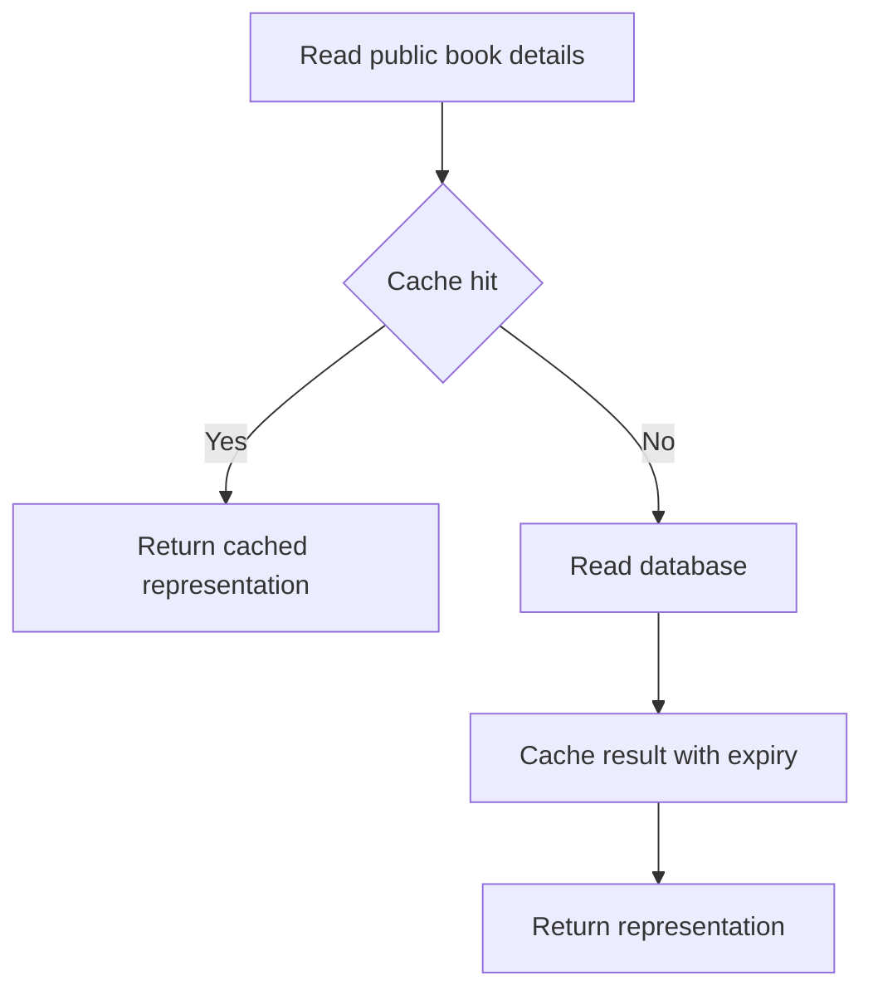

# Caching — Remembering the Answer, Briefly

*Post 15 of 31 · [Series index](README.md)*

The bookstore homepage keeps asking the database for the same popular books. The database keeps answering. Both parties are behaving correctly, which is apparently no defense against unnecessary work.

A cache stores a reusable result closer to the place it is needed. It can reduce repeated computation, network trips, or pressure on another system. The tradeoff is that the remembered answer can stop being true.

This post develops Sriniously’s caching lesson through our catalog and checkout. The design examples are illustrative. We have not measured a deployed bookstore or claimed a performance improvement.

## Start with a reuse opportunity

Caching is useful when work is repeated, the cached result is cheaper to retrieve, and some defined degree of staleness is acceptable.

| Bookstore data | Possible policy | Main concern |
| --- | --- | --- |
| Versioned book-cover image | Long-lived browser or CDN cache | Publish a new URL when the image changes |
| Popular-books list | Short-lived shared application cache | Agree how quickly changes must appear |
| Public book details | Cache by representation and relevant options | Price, language, and currency differences |
| Customer order history | Usually private or uncached initially | Authorization and privacy |
| Stock accepted at checkout | Verify through authoritative transaction | A stale count can oversell |

A cache is an optimization around a defined source of truth. If losing a Redis key would lose the only copy of an accepted order, that key is carrying primary-storage responsibilities and needs a different reliability design.

## Caches exist at several layers

The lesson discusses browser and CDN caching, DNS caching, hardware caches, and in-memory application stores. They all reuse information, but their keys, lifetimes, and correctness rules differ.

A CPU cache is managed through hardware and memory-system rules. A DNS resolver reuses DNS answers according to DNS behavior. A CDN can reuse eligible HTTP responses near users. An application can reuse a prepared catalog result in Redis.

Redis is one option for a shared in-memory store. An in-process dictionary is another kind of cache, but each application instance has its own copy and memory budget. Multiple instances make invalidation more complicated. Also, Memcached should not be assumed to provide Redis-style persistence simply because both are used for caching.

Choose the layer that removes the actual repeated work. Adding Redis cannot remove an expensive image download that the browser could have reused directly.

## Cache-aside follows the read path

With cache-aside, the application checks the cache, retrieves a missing value from the source, and caches that result for later requests. On a write, a common policy updates the database and then invalidates the corresponding cached entry. [Microsoft cache-aside pattern](https://learn.microsoft.com/en-us/azure/architecture/patterns/cache-aside)



The following pseudocode includes a bounded cache-failure path.

```text
readPublicBook(bookId, locale, currency)
    key = buildVersionedKey(bookId, locale, currency)
    try cache read with a short timeout
    if usable hit exists
        return cached representation
    otherwise
        load visible book from the database
        construct the public representation
        try cache write with an expiry
        return representation
```

If the cache is unavailable, the database may still serve the request. That fallback needs capacity limits. A failing cache that suddenly sends every request to the database can turn one incident into two.

## Key design is part of correctness

This illustrative key makes several representation choices explicit.

```text
catalog:v2:book:book_42:locale:en-US:currency:USD
```

The version separates incompatible cached formats. Locale and currency distinguish different results. A collection key may also need normalized filters, sort order, and pagination position.

If a response depends on tenant, user identity, or permissions, those differences need correct isolation. Often the simpler first design is to avoid shared caching of that response. A high hit rate is less impressive when the hits belong to somebody else.

Do not put raw credentials or sensitive personal data into keys, where logs and administrative tools may expose them. Cache only the fields that the consumer needs, and apply access controls to the cache itself.

## Expiration and invalidation solve different problems

A time to live limits how long an entry remains eligible for reuse under that expiry policy. Invalidation removes or supersedes an entry when relevant data changes. Neither alone gives arbitrary consistency guarantees.

Suppose a reader loads an old price, a writer commits a new price and deletes the cache key, and the reader then fills that key with the old result. Even “update the database, then delete the cache” has a race. A TTL may bound the stale entry’s subsequent lifetime, but it cannot make checkout safe.

Possible stronger designs include version-aware fills, coordinated invalidation, or bypassing the cache where current authoritative state is required. The choice should follow the allowed staleness and failure model. At checkout, our inventory transaction remains authoritative regardless of what the catalog page displayed.

Write-through coordinates cache and backing-store writes on the write path. Write-behind delays persistence and introduces additional loss and recovery considerations. Naming a strategy does not make two independent writes atomic. The Microsoft guidance discusses these strategy choices and their consistency tradeoffs. [Cache-aside considerations](https://learn.microsoft.com/en-us/azure/architecture/patterns/cache-aside)

## Memory pressure is different from age

Expiration is based on lifetime. Eviction removes entries to manage capacity according to a configured policy. Redis offers policies including approximate least-recently-used and least-frequently-used variants, with some policies considering all keys and others only keys with expiry. Its `noeviction` policy can cause qualifying writes to fail when memory limits are reached. Choose a policy for the actual workload. [Redis key eviction](https://redis.io/docs/latest/develop/reference/eviction/)

A cache should be allowed to forget. Application logic must handle misses without treating them as lost business records.

## Prevent a popular miss from becoming a crowd

When a popular key expires, hundreds of requests can all miss and repeat the same expensive work. This is commonly called a cache stampede.

For our bookstore, we could coalesce concurrent fills for the same key, add randomized expiry jitter across keys, or prewarm a small set of predictable popular results. Serving a slightly stale value while refreshing can also work when the freshness contract permits it.

Each choice needs boundaries. A distributed fill lock needs an expiry and safe ownership handling. Coalescing inside one process does not coordinate every application instance. Jitter spreads expirations across keys but does not eliminate contention on one very hot key.

Short-lived negative caching can reduce repeated lookups for absent books. It also delays visibility when a previously missing book is created, so use a deliberate policy rather than caching every error. A transient database failure is not proof that a book does not exist.

## Let HTTP caching do its share

HTTP cache directives distinguish storage, freshness, private reuse, and shared reuse. `no-store` tells caches not to store a response. `no-cache` permits storage but requires validation before reuse. `private` restricts storage to private caches. Validators such as ETags allow conditional requests that can return `304 Not Modified`. [MDN HTTP caching](https://developer.mozilla.org/en-US/docs/Web/HTTP/Guides/Caching)

For a versioned public cover image, long-lived caching can be appropriate. For account details, choose headers with privacy requirements in mind. When representation selection depends on request headers, `Vary` can help HTTP caches distinguish responses. It does not automatically repair an incorrectly designed application-cache key.

## Measure the saved work and the remaining risk

Track hit rate, miss latency, fill failures, eviction rate, cache memory, and database load. Measure tail latency too. A high average hit rate can hide expensive misses on the endpoint customers use to pay.

For illustration only, if cache hits take 2 ms, misses take 40 ms, and the hit rate is 90 percent, the weighted mean of those lookup paths is 5.8 ms. Real end-to-end latency includes other work and a distribution of timings. This calculation is an example, not a benchmark.

Caching earns its place when it removes measured work without violating the data contract. Our store can remember yesterday’s popular books for a little while. It still needs to count today’s last copy correctly.

## Lesson connection

This article draws on Sriniously’s [Caching, the secret behind it all](https://www.youtube.com/watch?v=estH64OkwxU), including caching layers, cache-aside, write strategies, eviction, and backend use cases. Key isolation, stale-fill races, stampede handling, and bookstore policies are additional explanation for this series.

[Previous — Business Logic](14-business-logic.md) · [Series index](README.md) · Next planned topic — Task Queues, Scheduling, and Transactional Email
