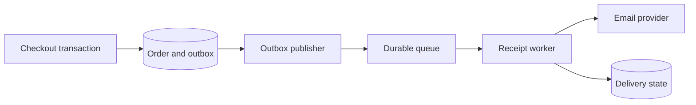

# Task Queues and Transactional Email — Your Receipt Is in Progress

*Post 16 of 31 · [Series index](README.md)*

Our bookstore has accepted an order. Now it needs to send a receipt. The email provider has chosen this moment to become contemplative.

Keeping the customer waiting for that provider couples checkout latency to a separate system. Background jobs let us record the required work durably and execute it outside the request-response lifecycle. The customer can receive an accurate order confirmation while receipt delivery continues.

This post develops the task-queue lesson from Sriniously’s playlist through the bookstore’s receipts, scheduled reports, and inventory reservations.

## Decide what must finish before the response

Checkout must establish whether the order was accepted. That includes the authorization, authoritative pricing, inventory reservation, and database transaction developed in earlier posts. Receipt delivery can follow later under a defined delivery policy.

| Work | Completion requirement in our example |
| --- | --- |
| Reserve inventory and create the order | Commit before reporting the order accepted |
| Record the need for a receipt | Persist with the accepted order |
| Contact the email provider | Perform through a worker |
| Produce a nightly sales report | Schedule a separate job |
| Release expired unpaid reservations | Run a scheduled reconciliation process |

Background work can still be essential to the business. Moving it out of the request creates a need for tracking, deadlines, and recovery. An in-process task that disappears when the server restarts cannot fulfill a durable delivery promise.

## Producer, broker, worker

A producer creates a job. A broker stores and delivers messages under its configured guarantees. A worker receives a message, validates it, and executes the handler associated with its type.



Our outbox publisher reads committed records and enqueues receipt jobs. Recording the order and its outbox event in one database transaction closes the failure gap between accepting the purchase and remembering the follow-up work. A publisher can crash after enqueueing and before marking an event published, so duplicate delivery still needs handling. [Transactional outbox pattern](https://docs.aws.amazon.com/prescriptive-guidance/latest/cloud-design-patterns/transactional-outbox.html)

The job below is an illustrative envelope.

```json
{
  "jobId":"receipt_order_1042_v1",
  "type":"send_order_receipt",
  "schemaVersion":1,
  "orderId":"order_1042",
  "templateVersion":1
}
```

The worker loads the accepted purchase snapshot and the delivery destination selected under our receipt policy. Sending yesterday’s receipt using today’s catalog prices would be an unusually efficient way to generate support tickets.

Keep messages bounded, versioned, and suitable for retries. Large attachments can live in controlled object storage with references in the job. Limit access to queues and delivery records because they can reveal customer and purchase information.

## Receiving a job does not complete it

Many queue systems require acknowledgment or deletion after successful processing. In Amazon SQS, receiving a message temporarily hides it through a visibility timeout. If processing does not finish and delete the message in time, it can become available again. Set the timeout for the workload, extend it when appropriate, and retain duplicate-safe behavior. [SQS visibility timeout](https://docs.aws.amazon.com/AWSSimpleQueueService/latest/SQSDeveloperGuide/sqs-visibility-timeout.html)

Acknowledging before completing the work can lose the task when a worker crashes. Completing the work before acknowledging can lead to another attempt if the acknowledgment is lost. SQS standard queues explicitly provide at-least-once delivery, so consumers must tolerate repeated messages. [SQS delivery semantics](https://docs.aws.amazon.com/AWSSimpleQueueService/latest/SQSDeveloperGuide/standard-queues-at-least-once-delivery.html)

Queue products differ. Redis Pub/Sub, for example, has at-most-once delivery and can lose a message when a subscriber is disconnected. Durable jobs require a system and configuration with the delivery and recovery behavior the workflow needs. [Redis Pub/Sub delivery semantics](https://redis.io/docs/latest/develop/pubsub/)

## A duplicate receipt is a distributed-systems problem

Suppose the provider accepts an email, but the response never reaches our worker. The worker cannot infer whether an email was sent from the timeout alone.

A unique job ID and an atomic claim prevent ordinary concurrent duplicate work. A durable completion record lets later deliveries return the stored outcome. Neither closes the crash gap between the external provider accepting the email and our database recording that result.

If the provider supports idempotent sends, use a stable operation key within its documented scope and retention window. Otherwise define how ambiguous outcomes are reconciled and what duplicate risk the product accepts. Marking a job complete before sending trades that risk for possible lost receipts.

This is why a worker’s behavior has to include the side effect, its outcome, and recovery. A `processed=true` field becomes meaningful only when we know exactly when it is written.

## Retry failures that can benefit from another attempt

A temporary network failure or provider throttle can justify another attempt. An invalid template or malformed recipient needs correction. Use capped exponential backoff with jitter, bounded attempts, and an overall deadline. Rate-limit workers to the provider’s capacity so increasing the worker count does not simply produce more rejections. [Timeouts, retries, and backoff with jitter](https://aws.amazon.com/builders-library/timeouts-retries-and-backoff-with-jitter/)

After the configured retry threshold, move persistently failing work to a dead-letter queue or equivalent failure store. Record the reason, alert the owner, repair the cause, and replay with the original logical identity. A dead-letter queue requires someone to look at it. Otherwise it is just a more expensive way of forgetting. [SQS dead-letter queues](https://docs.aws.amazon.com/AWSSimpleQueueService/latest/SQSDeveloperGuide/sqs-dead-letter-queues.html)

## Scheduling adds time and overlap

A one-off receipt job follows an order. A nightly report follows a schedule. A batch job fans out over many records. A chain expresses dependencies, such as generating a PDF before sending its download link.

For recurring work, define the timezone, daylight-saving behavior, missed-run policy, and overlap policy. “Every day at 9” leaves several decisions to the computer, which will make them without consulting us.

A reservation-expiry job should conditionally transition only reservations that are still eligible. It may run late, run twice, or overlap with payment confirmation. The database operation must arbitrate those races. A scheduler’s timing accuracy cannot provide the missing business guarantee.

For large reports, divide work into bounded chunks and track progress. If later steps depend on earlier results, represent those dependencies explicitly and record failures at the appropriate step.

## Track email beyond the send call

A provider accepting a send request establishes one delivery stage. Subsequent delivery events, bounces, and complaints need their own handling. Amazon SES exposes these events through its notification mechanisms. Our delivery state should distinguish queued, submitted, delivered where reported, and failed outcomes. [SES event notifications](https://docs.aws.amazon.com/ses/latest/dg/monitor-sending-activity-using-notifications.html)

The checkout page can say the order is confirmed and the receipt is being prepared. It should claim “delivered” only when the corresponding evidence and product definition support that wording.

For verification or password-reset emails, add purpose-bound, expiring, single-use tokens, controlled resend behavior, and safe logging. The queue may retry the delivery after a token expires, so the worker needs a policy for obsolete jobs too.

## Check the recovery paths

- Crash the publisher after enqueueing and confirm a repeated event preserves the intended outcome.
- Crash a worker after the provider accepts a send and exercise the ambiguity policy.
- Deliver the same message concurrently and check atomic claims.
- Make a job exceed its visibility window and observe redelivery.
- Run a scheduled task twice and verify that reservations or reports remain consistent.

Track the age of the oldest pending job, processing latency, attempt counts, failure-store growth, and provider outcomes. Queue length alone cannot tell us whether a customer’s receipt has been waiting for three hours.

## Lesson connection

This article draws on the producer, broker, worker, acknowledgment, retry, scheduling, and task-design discussion in Sriniously’s task-queue lesson. The bookstore outbox, delivery-state model, and recovery examples extend that material. Post numbering follows this series’ editorial roadmap. [Task queues and background jobs](https://www.youtube.com/watch?v=r-nQsyguU1Y)

[Previous — Caching](15-caching.md) · [Series index](README.md) · [Next — Elasticsearch and Full-Text Search](17-elasticsearch-and-full-text-search.md)
