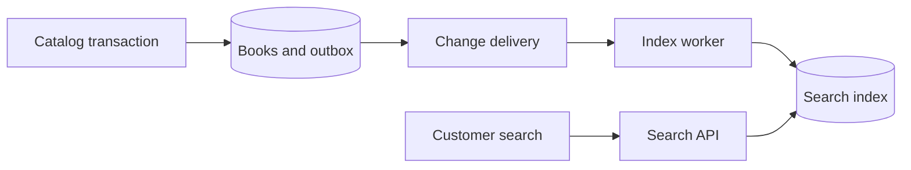

# Elasticsearch and Full-Text Search — Finding the Book You Meant

*Post 17 of 31 · [Series index](README.md)*

A customer searches for “distributed systems.” Our bookstore returns a novel whose description contains “distributed” and a cookbook that mentions “systems.” Both have followed instructions. Neither has understood the assignment.

Search involves finding candidates and ranking them according to the customer’s intent. It also involves spelling, language, filtering, freshness, and response time. The catalog has acquired a second job beyond remembering where we put the books.

This post develops Sriniously’s full-text-search lesson through a bookstore search endpoint, with Elasticsearch as the worked example.

## Start with the search requirements

Our first implementation might search title and description using case-insensitive substring matching.

```sql
SELECT id, title
FROM books
WHERE title ILIKE $1 OR description ILIKE $1
LIMIT 20;
```

The application binds a value such as `%distributed systems%`. That provides a defined substring operation, but it leaves relevance, word forms, and phrase interpretation to further design. A scan can become expensive as the dataset and traffic grow, although the actual plan depends on available indexes and the query.

PostgreSQL provides full-text search, including linguistic processing and ranking. It also supports indexed approaches to other search patterns. Adding a separate search service should follow requirements and measurements, with the added indexing pipeline and operational work included in the decision. [PostgreSQL full-text search](https://www.postgresql.org/docs/current/textsearch-intro.html), [PostgreSQL trigram indexes](https://www.postgresql.org/docs/current/pgtrgm.html)

For this example, suppose we want independently scaled search, configurable relevance, typo handling, and faceted catalog browsing. Elasticsearch gives us a place to implement those capabilities.

## An inverted index starts with terms

Consider three invented catalog entries.

| Document | Title |
| --- | --- |
| A | Distributed Systems in Practice |
| B | Database Systems |
| C | A Guide to Distributed Teams |

A simplified inverted index maps each term to documents containing it.

| Term | Documents |
| --- | --- |
| distributed | A, C |
| systems | A, B |
| database | B |

The intersection for “distributed” and “systems” identifies A. A real search engine stores additional structures and statistics for efficient matching, phrase positions, and scoring. Elasticsearch uses Lucene, whose indexing structures support this retrieval model. [Near-real-time search and Lucene segments](https://www.elastic.co/docs/manage-data/data-store/near-real-time-search)

The table is an explanatory sketch. It does not imply that all queries use intersection, or that the engine stores whole titles in these exact lists. The requested query semantics decide how terms combine.

## Analysis determines what a word becomes

Index-time analysis transforms text into searchable terms. Depending on the analyzer, it can tokenize, lowercase, remove selected words, or apply stemming. Search-time analysis transforms the query too. A mismatch between the two can produce surprising results.

Elasticsearch `text` fields support analyzed full-text values. `keyword` fields suit structured exact values such as language codes, ISBNs, and catalog status. A field can have both representations through multi-fields when it needs full-text matching and exact sorting or aggregation. [Elasticsearch text fields](https://www.elastic.co/docs/reference/elasticsearch/mapping-reference/text)

Here is an illustrative mapping for a new index. The `PUT /books-search-v1` request would carry this JSON body.

```json
{
  "mappings": {
    "properties": {
      "bookId":{"type":"keyword"},
      "title":{"type":"text"},
      "description":{"type":"text"},
      "language":{"type":"keyword"},
      "status":{"type":"keyword"},
      "priceMinor":{"type":"long"}
    }
  }
}
```

The default analysis is only a starting point. Our multilingual catalog needs deliberate language behavior. An ISBN should retain its identity, while an English description may benefit from language-aware processing. Inspect analyzer output with representative examples before tuning relevance around assumptions about tokens.

## Match, filter, rank

Our application could send `POST /books-search-v1/_search` with this illustrative body.

```json
{
  "size":20,
  "query": {
    "bool": {
      "must": [
        {"match":{"title":{"query":"distributed systems","operator":"and"}}}
      ],
      "filter": [
        {"term":{"language":"en"}},
        {"term":{"status":"active"}}
      ]
    }
  }
}
```

The `match` query analyzes the supplied text. Here `operator: and` requires the resulting query terms, subject to the analyzer and query behavior. A default OR-style match would admit a broader candidate set. Phrase queries address a different requirement involving term positions. [Elasticsearch match query](https://www.elastic.co/docs/reference/query-languages/query-dsl/query-dsl-match-query)

The filters express eligibility without contributing relevance scores. For a larger search experience, title and description can both participate with explicit field boosts. Prioritizing title matches is a choice we make for our store. [Query and filter context](https://www.elastic.co/docs/reference/query-languages/query-dsl/query-filter-context)

Elasticsearch uses BM25 as its default lexical similarity. It considers term statistics and document length, with configurable behavior. Field boosting and other ranking rules build on that scoring model. A score helps order results for a query. Treating it as a universal percentage of correctness would give a number more confidence than it has earned. [Elasticsearch similarity settings](https://www.elastic.co/docs/reference/elasticsearch/index-settings/similarity)

## Typo tolerance needs boundaries

Fuzzy matching can help a query such as “distrbuted” find relevant terms. It expands the work and can introduce unwanted matches, particularly for short tokens and identifiers. Exact ISBN lookup deserves different handling from a misspelled title.

Autocomplete also has distinct requirements. Prefix matching, completion suggestions, and ordinary full-text search answer different interaction patterns. Choose the supported query behavior and bound query length, expansion, and page sizes. Giving every keystroke unrestricted query syntax is an energetic way to discover capacity limits.

## Keep the index synchronized with the catalog

The bookstore’s database remains authoritative for accepted prices and inventory. Search uses a projection containing the fields needed to find and display eligible books.



Use stable document IDs so repeated updates target the same document. Track source versions or otherwise reject older events, since an out-of-order update can overwrite a newer price or resurrect an archived listing. Deletion and archival events belong in the synchronization design too.

There are at least two freshness delays. The change must reach the index worker, and indexed changes must become visible to search through refresh. Elasticsearch’s near-real-time behavior depends on refresh policy and deployment settings. Budget for the whole pipeline rather than promising a universal one-second result. [Elasticsearch refresh behavior](https://www.elastic.co/docs/manage-data/data-store/near-real-time-search)

When a customer buys a search result, checkout revalidates authoritative sale conditions. An indexed availability flag provides browsing information. The inventory transaction decides whether a purchase can be accepted.

## Pagination and rebuilding are part of the feature

Deep `from` and `size` pagination can demand substantial work across shards. Elasticsearch supports `search_after`, and a point-in-time context can preserve a consistent view while paging. Keep sort criteria and continuation values aligned, and close resources according to their lifecycle. [Paginating Elasticsearch results](https://www.elastic.co/docs/reference/elasticsearch/rest-apis/paginate-search-results)

Mapping changes can require a new index. A controlled rebuild creates the new index, loads a source snapshot, captures concurrent changes, verifies completeness and relevance, and switches the application’s index alias or configuration. Reconcile updates and deletes around the snapshot boundary so the new index does not quietly lose edits made during the rebuild.

## Evaluate what customers actually find

Build a small set of representative queries with expected relevant results. Include exact titles, authors, ISBNs, misspellings, broad topics, multiple languages, and zero-result cases. Compare ranking quality alongside latency, indexing lag, and error rates.

Performance comparisons need comparable datasets, query semantics, returned fields, hardware, and warm-up conditions. The lesson’s demonstration motivates the topic. Our bookstore needs its own measurements before attaching a speedup to its README.

## Lesson connection

This article draws on the lesson’s substring-search limitations, inverted indexes, relevance, analysis, and Elasticsearch demonstration. The bookstore mapping, synchronization pipeline, pagination, and rebuild discussion extend the lesson. [Full-text search using Elasticsearch](https://www.youtube.com/watch?v=7_sovzAhRSM)

[Previous — Task Queues and Transactional Email](16-task-queues-and-transactional-email.md) · [Series index](README.md) · [Next — Error Handling](18-error-handling.md)
