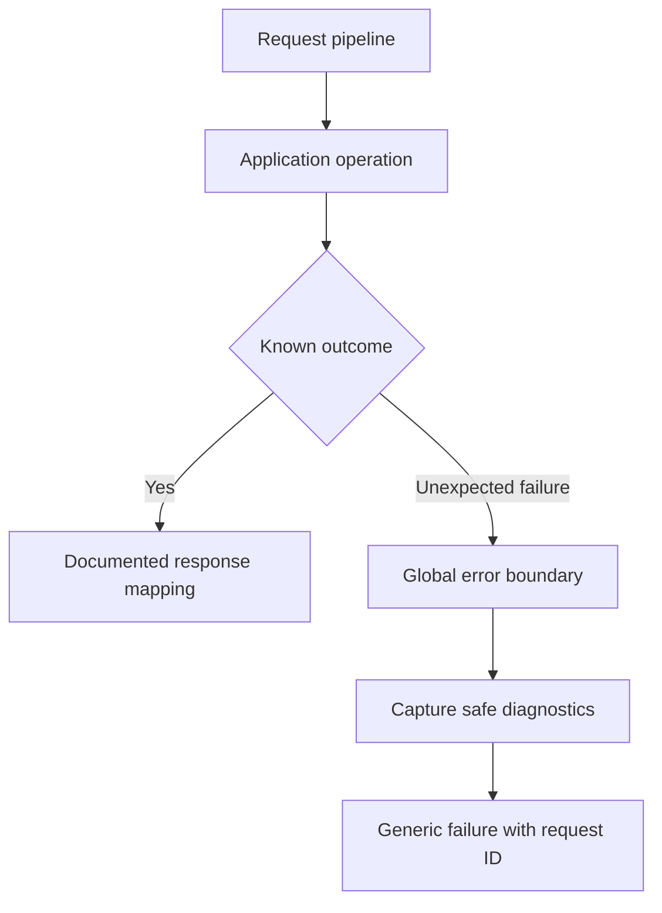

# Error Handling — The Order May Already Exist

*Post 18 of 31 · [Series index](README.md)*

The customer presses Place order. The browser waits. Then it announces that something went wrong, which is accurate in the least informative way available.

Perhaps the request never arrived. Perhaps the database rolled back. Perhaps checkout committed and only the response was lost. The same spinning button can conceal three very different outcomes.

Error handling connects failures to an honest response, a safe recovery action, and enough operational context to investigate. This post develops Sriniously’s fault-tolerance lesson through the checkout, search, and background jobs we have built so far.

## Classify the failure where its meaning is known

| Failure | Application meaning | Response or recovery in our example |
| --- | --- | --- |
| Invalid quantity | Input cannot be accepted | Return field-level validation information |
| Insufficient stock | Current business condition blocks purchase | Return a documented conflict |
| Missing or hidden order | Caller cannot retrieve this resource | Follow the API’s visibility policy |
| Database deadlock | Transaction failed during contention | Roll back and consider a bounded whole-transaction retry |
| Provider timeout | External outcome may be unknown | Reconcile or retry under the operation’s idempotency contract |
| Programming defect | Implementation failed unexpectedly | Return a generic error and capture diagnostics |
| Invalid required configuration | Service cannot perform its role | Fail startup validation or remain unready |

A database constraint violation also needs interpretation. A known uniqueness rule might produce a client-visible conflict. A broken internal relationship could indicate an implementation defect. Blindly translating every constraint failure into “bad input” gives the caller responsibility for problems they cannot fix.

Application code should translate recognized infrastructure errors into meaningful domain outcomes where it has the context to do so. Preserve the underlying cause for investigation, and allow unexpected failures to reach the appropriate outer boundary.

## Keep one HTTP response policy

Our HTTP boundary maps application outcomes into a stable public contract. That keeps endpoint behavior consistent and gives unexpected exceptions a final handler.



A global handler covers the request pipeline according to framework behavior. Workers, scheduled processes, startup code, and failures after a response has begun need their own boundaries. Catching an exception cannot retroactively replace bytes already sent to the client.

An illustrative adapter might follow this policy.

```text
invoke application operation
if it returns a documented domain failure
    map to the agreed status and problem representation
if it raises an unexpected exception before the response starts
    record the cause with the request ID
    return a generic internal failure
always release owned resources
```

Avoid a blanket catch that returns a success-shaped empty result. A failed order query and a customer with no orders have different meanings, and the UI needs to distinguish them.

## Make errors understandable to clients

RFC 9457 defines Problem Details for HTTP APIs, including standard members and extension fields. Our proposed insufficient-stock response uses `application/problem+json` and this body. A real implementation would publish the referenced problem-type documentation. [Problem Details specification](https://www.rfc-editor.org/rfc/rfc9457.html)

```json
{
  "type":"/problems/insufficient-stock",
  "title":"Insufficient stock",
  "status":409,
  "detail":"One or more requested books are no longer available in that quantity.",
  "instance":"/requests/req_89",
  "code":"INSUFFICIENT_STOCK",
  "requestId":"req_89"
}
```

Keep the actual HTTP status aligned with the problem representation. Let clients branch on documented identifiers and structured extensions. Human-readable wording can then improve without breaking every frontend condition.

For our API, malformed requests can use `400`, understood content that fails semantic validation can use `422`, and a conflict with current resource state can use `409`. Missing authentication, forbidden access, hidden resources, rate limits, and unexpected failures need their own documented treatment. These mappings depend on the contract and the actual cause. [HTTP client and server error semantics](https://www.rfc-editor.org/rfc/rfc9110.html#section-15.5)

Keep SQL text, stack traces, credentials, and private record details out of public error bodies. Authentication and account-recovery endpoints also need responses that follow the application’s account-enumeration policy.

## A timeout creates uncertainty

Suppose checkout commits order 1042, but the connection fails before the response reaches the customer. Telling the customer “your order failed” would assert something the server has not established from the observed timeout.

A stable client operation key lets a retry retrieve the accepted outcome. Scope the key to the actor and operation, compare the payload fingerprint, and atomically record the result with the business changes. Concurrent attempts need consistent in-progress behavior.

For an external payment or email provider, inspect its documented idempotency and lookup facilities. A local timeout may leave the remote operation running. Retrying safely requires a way to prevent duplicate effects or reconcile the ambiguous outcome.

Timeouts also need a budget. If the entire request has two seconds left, a dependency call with a thirty-second timeout will outlive the useful request. Coordinate connection, request, and overall deadlines, and propagate cancellation where the libraries support it. [Timeouts and retry design](https://aws.amazon.com/builders-library/timeouts-retries-and-backoff-with-jitter/)

## Retry with a reason and a stopping point

A malformed payload will remain malformed after a short nap. A transient transport failure may recover. Retry only when both the failure and operation semantics permit another attempt.

Set maximum attempts, capped backoff, jitter, and an overall retry budget. Retry at a chosen layer because independent retries in the caller, service client, and worker can multiply load. Honor applicable provider guidance and HTTP `Retry-After` values within the operation’s deadline. [HTTP Retry-After](https://www.rfc-editor.org/rfc/rfc9110.html#section-10.2.3)

For a failed database transaction, retry the complete logical unit when appropriate, after rollback. Replaying only the final write can reuse stale reads or omit earlier steps. For a side effect whose outcome is unknown, reconcile first or use the operation’s idempotency mechanism.

Repeated failures should become visible to the operator. Our receipt worker moves exhausted work into a failure store with its job identity and reason, so a repair can be followed by a controlled replay.

## Contain a dependency failure

When search is unavailable, the store might offer a documented fallback to a simpler catalog browse. That path needs its own capacity budget and clear behavior. Sending all search traffic to an already busy database can expand the outage.

A circuit breaker can stop repeated calls to a failing dependency for a period, then allow controlled probes. Concurrency limits, bounded queues, and separate worker pools can limit how much resource a slow dependency consumes. Choose the behavior according to the operation’s importance and recovery requirements.

Checkout should preserve its accepted-order guarantees during degradation. If authoritative inventory cannot be checked, the application needs an honest unavailable outcome. It cannot infer stock from the last cached page.

## Capture the context needed to investigate

Useful diagnostics include the request or job ID, operation, failure category, dependency, attempt number, elapsed time, and a safe internal cause. Apply redaction and access controls to logs. Passwords, bearer tokens, payment details, and full request bodies should not appear through a convenient exception dump.

Track failure rate and latency by operation, alongside queue age and dependency outcomes. A service that returns quickly because every checkout fails has excellent latency and a short business future.

Health checks should answer the question the platform actually asks. Liveness concerns whether restarting the process is warranted. Readiness concerns whether it should receive work. Treating every shared dependency outage as a liveness failure can cause a fleet of restarts without repairing the dependency.

## Exercise failure as part of the workflow

- Lose a checkout response after commit and retrieve the existing outcome through a retry.
- Force a transaction rollback and confirm stock and order records remain consistent.
- Simulate a slow provider and verify bounded resource use.
- Trigger an unexpected exception and inspect both the public response and protected diagnostics.
- Fail search and exercise the fallback at realistic load.
- Crash a receipt worker at the external-call boundary and verify its recovery policy.

These checks give each recovery path a concrete meaning. The customer gets an accurate next step, and the operator gets a traceable failure instead of an evening spent asking which “something” went wrong.

## Lesson connection

This article draws on the lesson’s error categories, recovery strategies, propagation, global handling, health checks, and security discussion. The bookstore timeout scenario, response contract, and failure checks extend that material. [Error Handling and Building Fault Tolerant Systems](https://www.youtube.com/watch?v=8NaM_9aKS24)

[Previous — Elasticsearch and Full-Text Search](17-elasticsearch-and-full-text-search.md) · [Series index](README.md) · Next planned topic — Configuration Management
